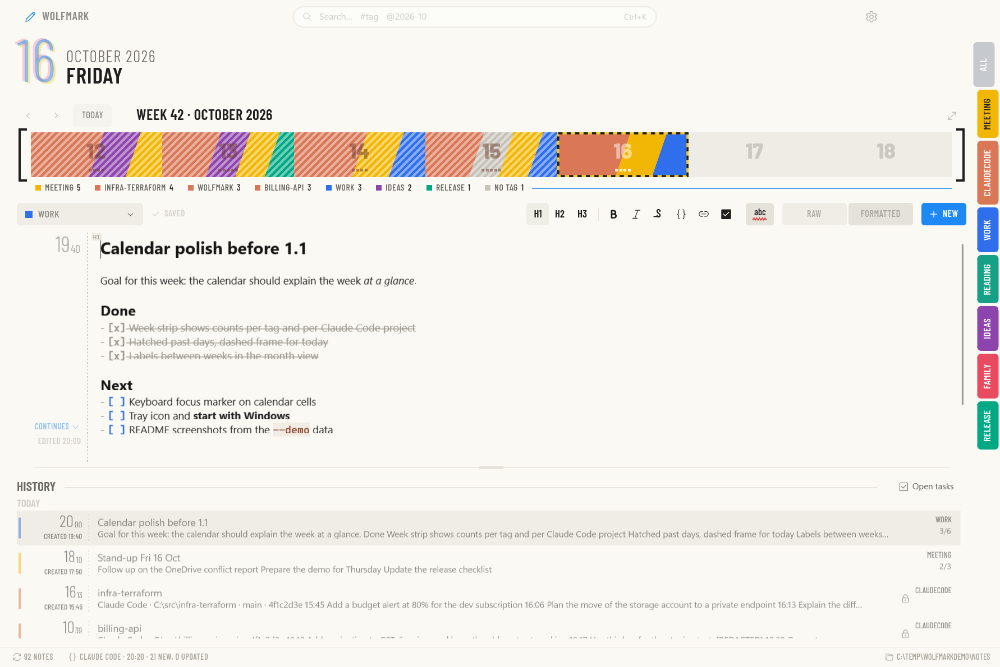
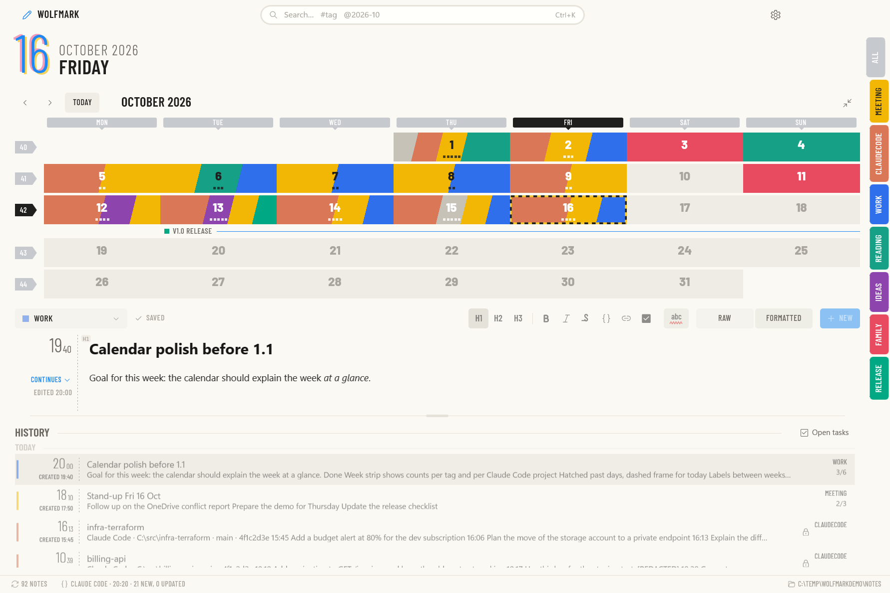
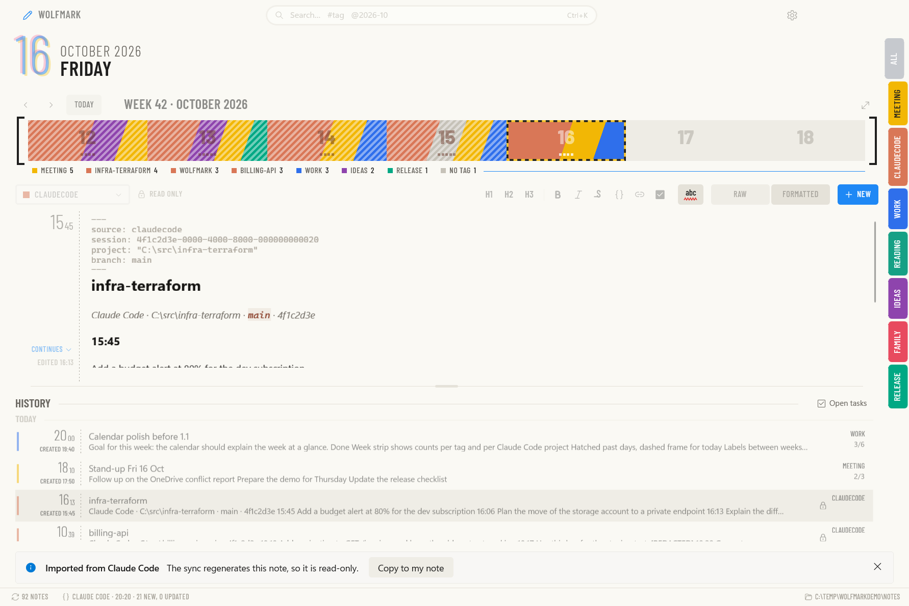
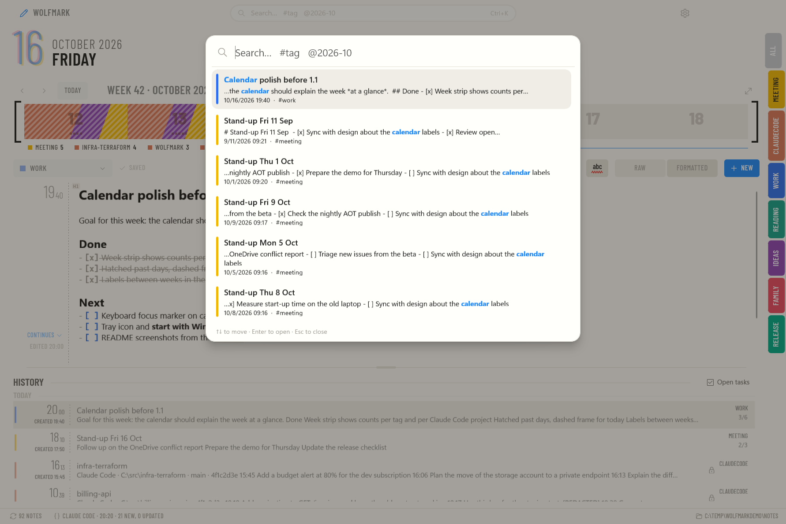
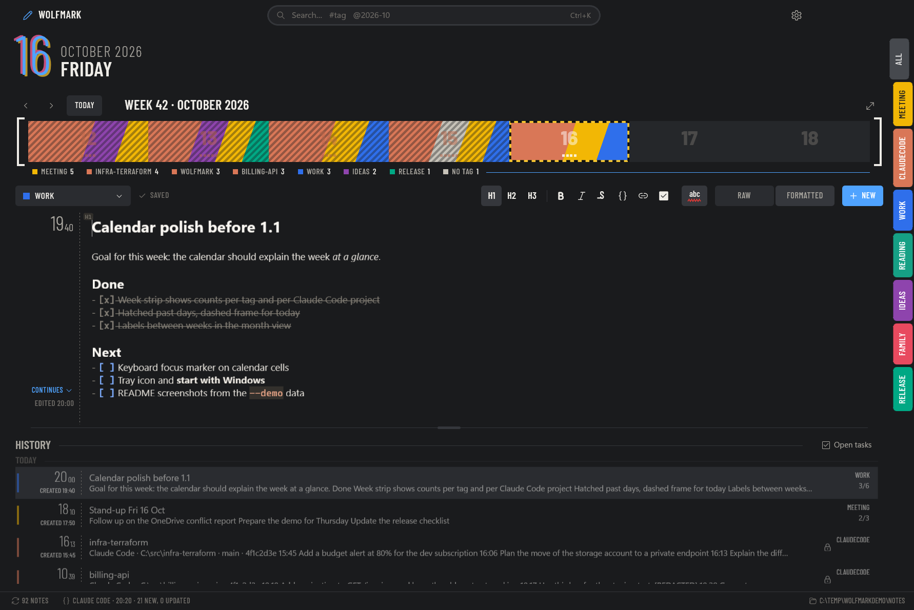

<div align="center">

# WolfMark

**A fast, native daily notebook for Windows – plain Markdown files, a calendar that tells the story of your week,
and your Claude Code sessions captured automatically.**

.NET 11 · WinUI 3 · Native AOT · SQLite · MIT



</div>

---

## Why WolfMark

- **Open it and type.** Native AOT start-up, the last note opens with the caret at the end, autosave in the background.
  No loading screens, no sign-in, no sync service of its own.
- **Your notes are files.** Every note is an ordinary `.md` file in a dated folder – by default in your OneDrive.
  Readable without the app, backed up by OneDrive, easy to grep, diff or move.
- **The calendar is the index.** Colour-coded tags turn days into a visual log; the week strip shows what the week
  was about at a glance.
- **Your AI work is part of the journal.** Prompts you give Claude Code are imported as read-only notes, one per
  session, grouped by project.

## Features at a glance

| | |
|---|---|
| **Markdown editor** | Formatted (live preview) and raw mode over one text model, `Ctrl+E` to switch; headings, lists, tasks, quotes, code, links; toolbar and context menu; native spell check |
| **Calendar** | Week strip with per-tag counts, full month view with labels, hatched past days, keyboard navigation |
| **Tags** | Primary tag in the file name (`work_1403.md`), extra tags inline (`#idea`) or in front matter; colours sync with the notes |
| **History** | Virtualised list of all notes ordered by last edit, filter by tag, day or open tasks |
| **Search** | `Ctrl+K` command palette, SQLite FTS5 full-text with `#tag` and `@2026-10` filters; optional semantic search |
| **Claude Code sync** | Human prompts from `~/.claude/projects` become notes, per session and day, secrets redacted |
| **Windows integration** | Light/dark theme, notification-area icon, start with Windows, single instance |
| **Robust storage** | Atomic writes, recycle bin instead of delete, OneDrive placeholders and conflict copies handled |

---

## The calendar



The calendar never reads files itself – it is drawn from a materialised `calendar_days` table that the indexer keeps
up to date, so it stays instant even with years of notes.

- **Week strip.** The compact view under the title bar shows the current week. Each day is filled with the colour of
  its dominant tag, small dots show how many notes it has, past days are hatched and today has a two-tone dashed
  frame.
- **What the week was about.** Under the strip, a summary line counts the week's notes per tag – for example
  `■ WORK 6  ■ MEETING 5  ■ WOLFMARK 4  ■ BILLING-API 2  ■ NO TAG 1`. Claude Code sessions are counted **per project**
  instead of under a single tag, so you can see where your AI time went.
- **Month view.** `Ctrl+Shift+C` expands the full month: ISO week numbers, weekday labels and **labels between weeks**
  taken from tags you mark as calendar labels (e.g. a `release` note becomes `■ V1.0 RELEASE ———`).
- **Tag rail.** Vertical tabs on the right edge select an active tag: the history is filtered, other days are dimmed
  and new notes get that tag.
- **Keyboard first.** Arrows move between days, `Enter` opens a day, `Esc` closes the month view,
  `Ctrl+Alt+←/→` moves by week. Cells are announced by Narrator.
- Weeks start on Monday, month and day names follow the UI language (English or Slovak).

## Claude Code sync



WolfMark reads the transcripts Claude Code keeps on your machine
(`%USERPROFILE%\.claude\projects\<project>\<session>.jsonl`) and turns them into notes:

- **Only what you typed.** Human prompts are imported; tool calls, tool results, system-injected messages and
  compaction notices are skipped.
- **One note per session and day** – `YYYY/MM/DD/ClaudeCode_HHmm.md`, titled with the project name. Each prompt is
  a `### 14:03` section with its text; sessions that run past midnight continue in the next day's note.
- **Idempotent.** The import position per session is stored in the index; re-running only appends new prompts.
- **Runs by itself** at start-up, on an interval (default 10 minutes) and optionally in real time with a file watcher.
- **Privacy built in.** API keys and tokens (`sk-…`, `ghp_…`, connection strings and similar) are redacted before
  anything is written to OneDrive, and whole projects can be excluded by path.
- **Read-only in the editor** – the transcript stays the source of truth.
- **Retention warning.** Claude Code deletes old transcripts after `cleanupPeriodDays` (30 by default); WolfMark
  warns you and can raise the value in `~/.claude/settings.json` for you.

## Your data: plain Markdown in OneDrive

WolfMark has no database of record and no cloud of its own. **The files are the truth**; everything else can be
rebuilt from them.

**Where notes live.** By default in `%OneDrive%\WolfMark` (falling back to `OneDriveConsumer` /
`OneDriveCommercial`, then `Documents\WolfMark`). The folder can be changed in Settings, with the option to move
existing notes or just switch.

```
OneDrive\WolfMark\
├─ 2026\
│  └─ 10\
│     └─ 16\
│        ├─ 0927.md                 # untagged note created at 09:27
│        ├─ work_1403.md            # primary tag "work", created at 14:03
│        ├─ ClaudeCode_1655.md      # imported Claude Code session
│        └─ assets\                 # images pasted into that day's notes
└─ .wolfmark\
   └─ tags.json                     # tag colours, order and calendar labels – travels with the notes
```

**File names carry the metadata.** The date is the folder, the time and primary tag are the file name:
`<tag>_<HHmm>[ss][-n].md` or `<HHmm>.md`. Changing a note's tag renames the file; the creation time never changes.
Files that do not follow the convention are still indexed and marked as non-standard.

**Safe by design.**
- Every save is **atomic** – written to a hidden temp file next to the note and swapped in, so OneDrive never
  uploads half a file.
- Deleting a note sends it to the **Windows Recycle Bin**; nothing is removed permanently.
- **Files On-Demand** placeholders are recognised: the calendar uses metadata only and content is fetched lazily in
  the background, so opening the app never downloads your whole archive.
- **Conflict copies** that OneDrive creates when two PCs edit the same note (`work_1403-LAPTOP.md`) are detected
  and shown in the UI.
- Changes made outside the app (another PC, a text editor) are picked up by a file watcher and re-indexed.

**What stays on the machine.** `%LOCALAPPDATA%\WolfMark` holds the SQLite index (WAL mode, single writer, FTS5 and
optional vectors), downscaled image previews (`cache\previews`), logs and window placement. It is a cache – delete `index.db` and WolfMark rebuilds it from the
files.

## Search, editor and the rest



- **Search** (`Ctrl+K`): full-text over titles and bodies with diacritics-insensitive matching, `#tag` and
  `@YYYY-MM` filters, results ranked with BM25 and, when the embedding model is available, fused with semantic
  similarity. With text selected in the editor, picking a result inserts a link to it.
- **Editor**: formatted mode hides Markdown markers outside the current line, checkboxes are clickable; raw mode
  keeps the markers visible but muted. Highlighting runs incrementally in the background and never blocks typing.
  Copy as Markdown, plain text or HTML.
- **Images**: paste a screenshot or drop image files onto a note – they are copied into that day's `assets\`
  folder and linked relatively, so they travel with the notes. In formatted mode an image line shows the picture (up
  to five lines high) and behaves as one block: the caret sits before or after it, text typed there goes to its own
  line, Backspace/Delete remove the whole image. Double-click opens it in the default Windows viewer. Only images inside the notes folder are shown, never remote or network paths.

<table>
<tr>
<td></td>
<td></td>
</tr>
<tr>
<td align="center">Raw mode</td>
<td align="center">Dark theme</td>
</tr>
</table>

- **Windows**: Mica-backed flat design with Barlow typography, light and dark theme, a choice of app icons.
  Optionally WolfMark starts with Windows and keeps running in the notification area when the window is closed
  (left click shows it; the menu has *Show*, *Settings…* and *Exit*). Launching it again brings the existing window
  to the front.

## Keyboard shortcuts

| Shortcut | Action |
|---|---|
| `Ctrl+N` | New note (the file is created with the first character you type) |
| `Ctrl+K` / `Ctrl+Shift+F` | Search; with selected text, insert a link to the chosen note |
| `Ctrl+Shift+C` | Full calendar (arrows, `Enter`, `Esc`) |
| `Ctrl+Alt+←` / `Ctrl+Alt+→` | Previous / next week |
| `Ctrl+E` | Raw ↔ formatted mode |
| `Ctrl+B` / `Ctrl+I` / `Ctrl+Shift+L` | Bold / italic / task |
| `Tab` / `Shift+Tab`, `Enter` | Indent list, continue list |
| `Ctrl+,` | Settings |

---

## Download

Ready-to-run builds for **x64** and **ARM64** are on the [Releases](https://github.com/vlko/WolfMark/releases) page:
unzip and run `WolfMark.exe` – no installer, no .NET runtime needed (Native AOT, self-contained). The builds are not
signed yet, so Windows SmartScreen asks for confirmation on the first start.

Releases are built by [`.github/workflows/release.yml`](.github/workflows/release.yml) when a version tag is pushed:

```powershell
git tag v0.2.0          # v0.2.0-rc.1 for a pre-release
git push origin v0.2.0
```

## Building from source

Requirements: Windows 11 22H2 or later (build 22621), Visual Studio 2026 or the .NET 11 SDK from
[`global.json`](global.json).

```powershell
dotnet build WolfMark.sln -p:Platform=x64
dotnet test --solution WolfMark.CrossPlatform.slnf
dotnet run --project src/WolfMark.App -p:Platform=x64
dotnet build src/WolfMark.App -c Release -r win-x64 -p:Platform=x64     # creates WolfMark.pri, needed by publish
dotnet publish src/WolfMark.App -c Release -r win-x64 -p:Platform=x64   # Native AOT, self-contained (arm64: -r win-arm64 -p:Platform=ARM64)
```

The domain libraries and all tests also build and run on Linux/WSL
(`dotnet test --solution WolfMark.CrossPlatform.slnf`); the WinUI projects can be type-checked there but not run.

| Project | Contents | Target |
|---|---|---|
| `WolfMark.Core` | Note path/name grammar, tags and palette, Markdown lexer and incremental model, editing commands, undo, calendar maths, settings (System.Text.Json source generation) | `net11.0` |
| `WolfMark.Storage` | Directory engine (enumeration, CRUD, atomic writes, recycle bin), debounced watcher with echo suppression, `tags.json`, local settings, logging | `net11.0` |
| `WolfMark.Index` | SQLite (WAL, single writer), FTS5, sqlite-vec, incremental indexer, `calendar_days`, history, hybrid search | `net11.0` |
| `WolfMark.Sync.ClaudeCode` | Import of prompts from Claude Code transcripts, filtering, secret redaction, idempotent sync | `net11.0` |
| `WolfMark.Editor` | Markdown editor (RichEditBox + background lexer) | WinUI 3 |
| `WolfMark.App` | Window, calendar, history, search, settings – UI written in C# without XAML | WinUI 3 |

Engineering rules – no reflection under AOT, no I/O on the UI thread, files as the source of truth – are in
[`CLAUDE.md`](CLAUDE.md); design decisions in [`docs/adr`](docs/adr), the full specification in
[`SPEC.md`](SPEC.md) and the roadmap in [`BACKLOG.md`](BACKLOG.md).

### Regenerating the screenshots

The images above come from the real app running on generated demo data (English notes with a few tags and three
Claude Code projects, all relative to today). Demo mode keeps everything – notes, transcripts, settings and index –
inside the given folder and never touches your own notes:

```powershell
WolfMark.App.exe --demo %TEMP%\WolfMarkDemo                                  # explore the demo
WolfMark.App.exe --demo %TEMP%\WolfMarkDemo --screenshots docs\screenshots   # capture and exit
```

## Roadmap

Global quick-capture shortcut, jump list and `wolfmark://` links, tag rename/merge, daily view, wiki links and
backlinks, export, a local MCP server so Claude can search your notebook, and MSIX/winget distribution.
See [`BACKLOG.md`](BACKLOG.md).

## License

[MIT](LICENSE) © 2026 vlko. Barlow fonts are licensed under the SIL Open Font License.
