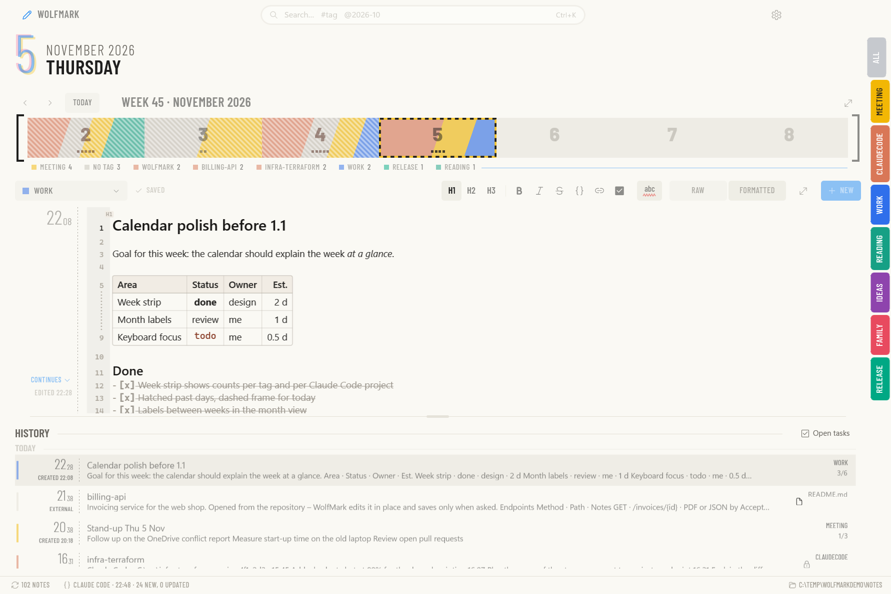
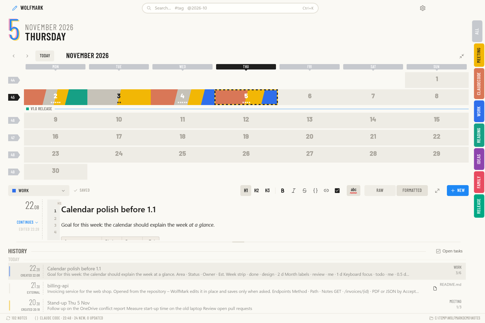
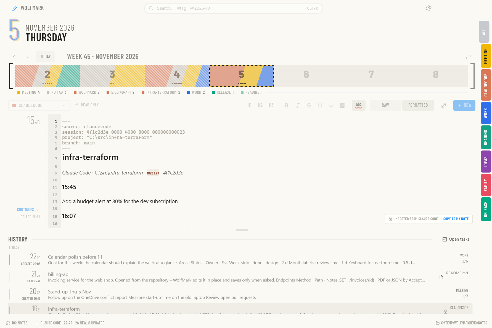
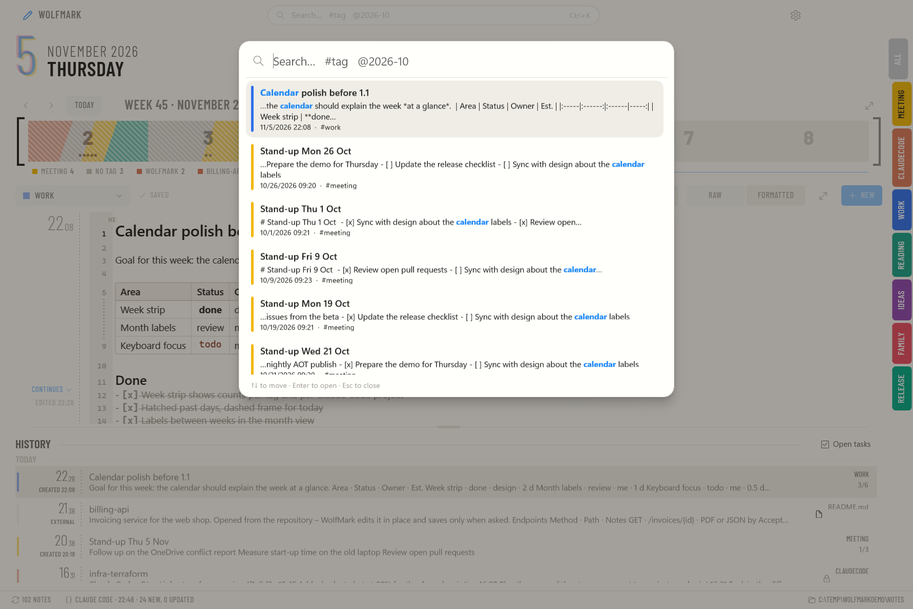
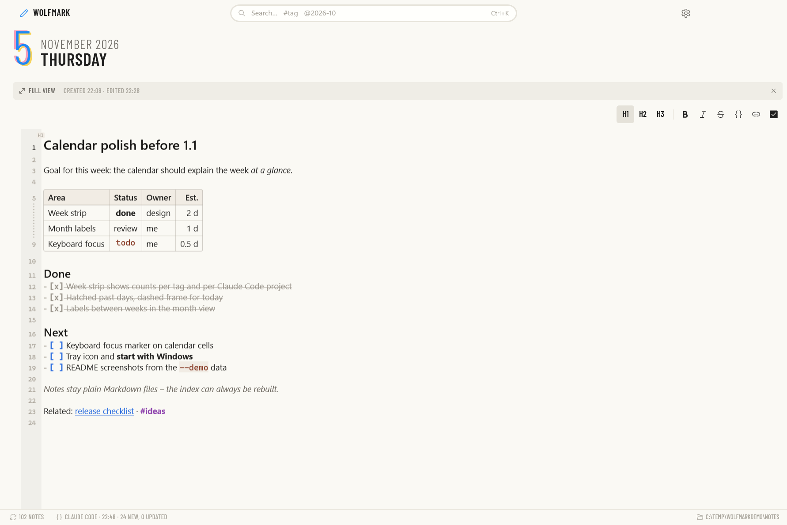
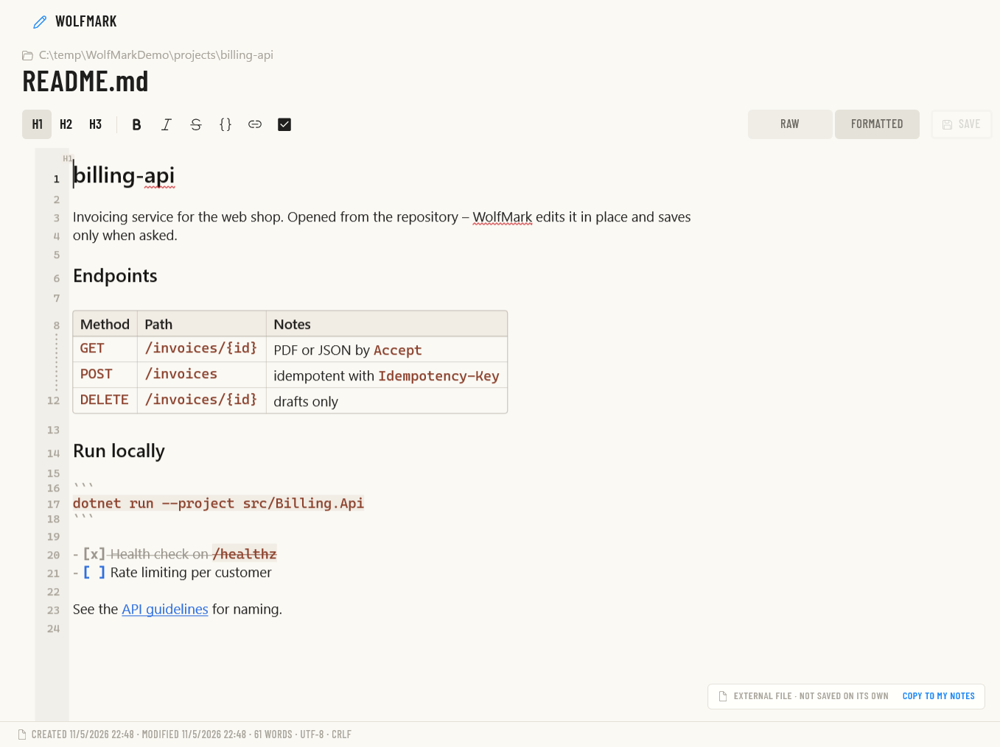
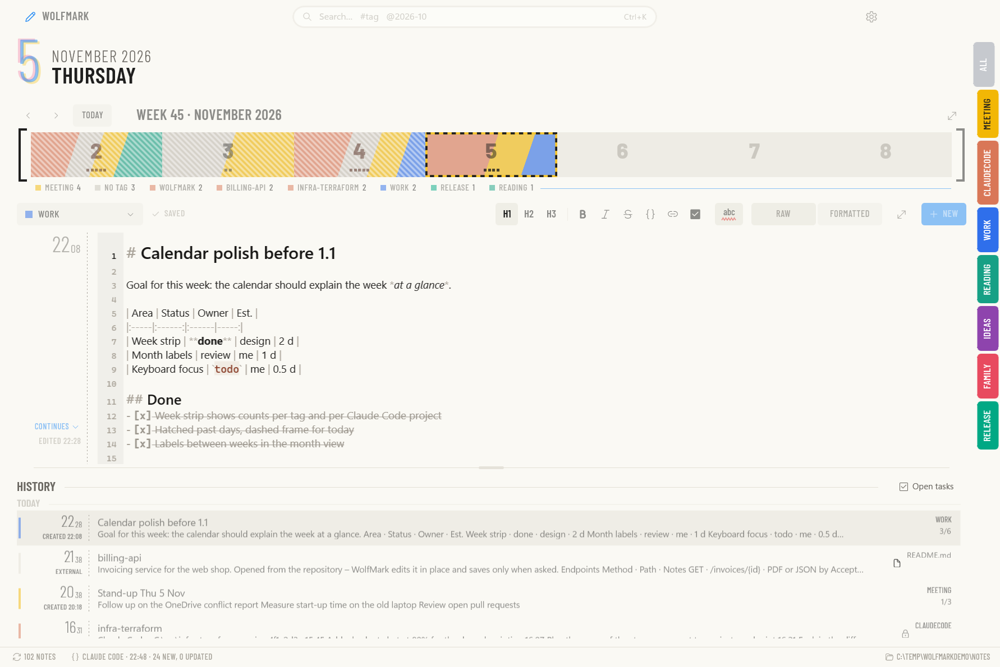
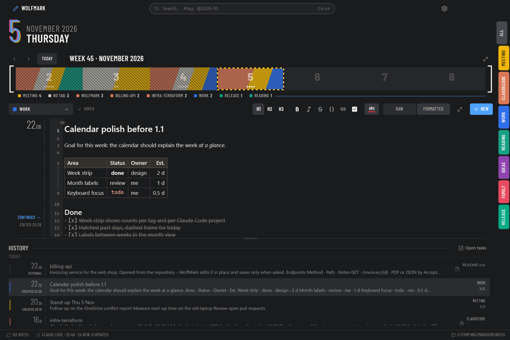

<div align="center">

# WolfMark

**A fast, native daily notebook – plain Markdown files, a calendar that tells the story of your week,
and your Claude Code sessions captured automatically. Windows, macOS and Linux.**

.NET 11 · Native AOT · WinUI 3 · Avalonia · SQLite · MIT



</div>

---

## Why I built it

My notes lived everywhere – a notes app here, a text file there, a cloud service that wanted an account and a
subscription. Every few years one of them went away and took a piece of my history with it. I wanted the opposite:
**notes as ordinary `.md` files in dated folders**, readable by any editor, backed up by OneDrive, easy to grep, diff
or move – and an app that is only a fast window onto them. Delete WolfMark tomorrow and nothing is lost.

It had to be **instant**. A notebook you have to wait for is a notebook you stop opening. WolfMark is compiled ahead
of time to native code; it opens on the note you were writing, caret at the end, and saves in the background. No
splash screen, no sign-in, no sync service of its own.

A daily notebook is really a diary of where your time went, so **the calendar became the index**. Every note has a
tag, every tag a colour, and a glance at the week strip tells you whether the week was meetings, a release or
firefighting.

Then more and more of my work moved into conversations with Claude Code – decisions, explanations, the *why* behind a
change – and all of it disappeared into transcripts nobody reads. So WolfMark **writes those sessions down by
itself**: what you asked, per project and day, next to your own notes.

And since it was already the place where I write Markdown, it became the app that opens every `.md` file on my
machine – a README in a repository, a note from another tool – in the same editor, without pulling it into the
notebook unless I ask.

## A day in WolfMark

- **Morning.** Open it and type. Yesterday's note is there; `Ctrl+N` starts a new one – the file is created with the
  first character, so empty notes never clutter the folder.
- **A meeting.** Pick the `meeting` tag; the day in the week strip takes its colour. Lists continue with `Enter`,
  `Ctrl+Shift+L` makes a task, a pasted screenshot lands in that day's `assets` folder and shows inline, a table
  shows as a grid until you step into it.
- **Deep work with Claude Code.** You talk to Claude in the terminal; WolfMark quietly imports what you asked into a
  read-only `ClaudeCode` note for the project. *Copy to my note* turns it into your own when you want to keep working
  on it.
- **A README to fix.** Double-click a `.md` file in Explorer or Finder: it opens in its own WolfMark window, saved only
  when you press *Save*, and shows up in the history so you can find it again.
- **"What did we decide last month?"** `Ctrl+K`, a few words, `#tag` or `@2026-10` – and with text selected, the result
  becomes a link.
- **Evening.** The week strip says what the week was about – `■ WORK 6  ■ MEETING 5  ■ WOLFMARK 4`, Claude Code
  sessions counted per project. `F11` hides everything but the note for a last calm read.

## Features at a glance

| | |
|---|---|
| **Markdown editor** | Formatted (live preview) and raw mode over one text model, `Ctrl+E` to switch; headings, lists, tasks, quotes, code, links, tables; toolbar and context menu; native spell check (Windows); font size with `Ctrl` `+`/`−`; colour emoji |
| **Tables & images** | GFM pipe tables as a grid with aligned, wrapped columns; pasted or dropped images copied next to the note and previewed inline |
| **Calendar** | Week strip with per-tag counts and hatched tag bands, full month view with labels between weeks, keyboard navigation |
| **Tags** | Primary tag in the file name (`work_1403.md`), extra tags inline (`#idea`) or in front matter; colours travel with the notes |
| **History** | All notes ordered by last edit, filter by tag, day or open tasks; Markdown files opened from elsewhere appear there too |
| **Search** | `Ctrl+K` command palette, SQLite FTS5 full-text with `#tag` and `@2026-10` filters; optional semantic search |
| **Claude Code sync** | Human prompts from `~/.claude/projects` become notes, per session and day, secrets redacted |
| **Markdown files anywhere** | WolfMark can open every `.md` file: notes switch the main window, other files open in their own window with *Save*, a status bar and *Copy to my notes* |
| **Full view** | `F11` (macOS `Ctrl+Cmd+F`): only the day, the formatting buttons and the note |
| **Desktop integration** | Light/dark theme, notification-area icon, single instance; start with Windows and app icon choice on Windows |
| **Robust storage** | Atomic writes, recycle bin instead of delete, OneDrive placeholders and conflict copies handled |

---

## The calendar



The calendar never reads files itself – it is drawn from a materialised `calendar_days` table that the indexer keeps
up to date, so it stays instant even with years of notes.

- **Week strip.** The compact view under the title bar shows the current week. Each day shows a band per tag in
  softened tag colours, small dots show how many notes it has, past days are finely hatched across the bands and
  today has a two-tone dashed frame.
- **What the week was about.** Under the strip, a summary line counts the week's notes per tag – for example
  `■ WORK 6  ■ MEETING 5  ■ WOLFMARK 4  ■ BILLING-API 2  ■ NO TAG 1`. Claude Code sessions are counted **per project**
  instead of under a single tag, so you can see where your AI time went.
- **Month view.** `Ctrl+Shift+C` expands the full month in full tag colours: ISO week numbers, weekday labels and
  **labels between weeks** taken from tags you mark as calendar labels (e.g. a `release` note becomes
  `■ V1.0 RELEASE ———`).
- **Tag rail.** Vertical tabs on the right edge select an active tag: the history is filtered, other days are dimmed
  and new notes get that tag.
- **Keyboard first.** Arrows move between days, `Enter` opens a day, `Esc` closes the month view,
  `Ctrl+Alt+←/→` moves by week. Cells are announced by Narrator.
- Weeks start on Monday, month and day names follow the UI language (English or Slovak).

## Claude Code sync



WolfMark reads the transcripts Claude Code keeps on your machine
(`%USERPROFILE%\.claude\projects\<project>\<session>.jsonl`) and turns them into notes:

- **Only what you typed.** Human prompts are imported; tool calls, tool results, system-injected messages and
  compaction notices are skipped.
- **One note per session and day** – `YYYY/MM/DD/ClaudeCode_HHmm.md`, titled with the project name. Each prompt is
  a `### 14:03` section with its text; sessions that run past midnight continue in the next day's note.
- **Idempotent.** The import position per session is stored in the index; re-running only appends new prompts.
- **Runs by itself** at start-up, on an interval (default 10 minutes) and optionally in real time with a file watcher.
- **Privacy built in.** API keys and tokens (`sk-…`, `ghp_…`, connection strings and similar) are redacted before
  anything is written to OneDrive, and whole projects can be excluded by path.
- **Read-only in the editor** – the transcript stays the source of truth; *Copy to my note* in the corner of the
  editor starts your own note from it.
- **Retention warning.** Claude Code deletes old transcripts after `cleanupPeriodDays` (30 by default); WolfMark
  warns you and can raise the value in `~/.claude/settings.json` for you.

## Your data: plain Markdown in OneDrive

WolfMark has no database of record and no cloud of its own. **The files are the truth**; everything else can be
rebuilt from them.

**Where notes live.** By default in `%OneDrive%\WolfMark` (falling back to `OneDriveConsumer` /
`OneDriveCommercial`, then `Documents\WolfMark`). The folder can be changed in Settings, with the option to move
existing notes or just switch.

```
OneDrive\WolfMark\
├─ 2026\
│  └─ 10\
│     └─ 16\
│        ├─ 0927.md                 # untagged note created at 09:27
│        ├─ work_1403.md            # primary tag "work", created at 14:03
│        ├─ ClaudeCode_1655.md      # imported Claude Code session
│        └─ assets\                 # images pasted into that day's notes
└─ .wolfmark\
   └─ tags.json                     # tag colours, order and calendar labels – travels with the notes
```

**File names carry the metadata.** The date is the folder, the time and primary tag are the file name:
`<tag>_<HHmm>[ss][-n].md` or `<HHmm>.md`. Changing a note's tag renames the file; the creation time never changes.
Files that do not follow the convention are still indexed and marked as non-standard.

**Safe by design.**
- Every save is **atomic** – written to a hidden temp file next to the note and swapped in, so OneDrive never
  uploads half a file.
- Deleting a note sends it to the **Windows Recycle Bin**; nothing is removed permanently.
- **Files On-Demand** placeholders are recognised: the calendar uses metadata only and content is fetched lazily in
  the background, so opening the app never downloads your whole archive.
- **Conflict copies** that OneDrive creates when two PCs edit the same note (`work_1403-LAPTOP.md`) are detected
  and shown in the UI.
- Changes made outside the app (another PC, a text editor) are picked up by a file watcher and re-indexed.

**What stays on the machine.** `%LOCALAPPDATA%\WolfMark` holds the SQLite index (WAL mode, single writer, FTS5 and
optional vectors), downscaled image previews (`cache\previews`), logs, window placement and the list of Markdown
files you opened from outside the notes folder (`settings.json`). It is a cache – delete `index.db` and WolfMark
rebuilds it from the files. On macOS it is `~/Library/Application Support/WolfMark`, on Linux `~/.local/share/WolfMark`.

## Search, editor and the rest



- **Search** (`Ctrl+K`): full-text over titles and bodies with diacritics-insensitive matching, `#tag` and
  `@YYYY-MM` filters, results ranked with BM25 and, when the embedding model is available, fused with semantic
  similarity. With text selected in the editor, picking a result inserts a link to it.
- **Editor**: formatted mode hides Markdown markers outside the current line, checkboxes are clickable; raw mode
  keeps the markers visible but muted. Highlighting runs incrementally in the background and never blocks typing.
  Copy as Markdown, plain text or HTML. Optional line numbers (an image counts as one line). Font size with
  `Ctrl` `+` / `Ctrl` `−` (or `Ctrl`+wheel); colour emoji. Links are not clickable – a click places the caret – but
  right-click on a web link offers *Open link in browser* (only `http`, `https` and `mailto`).
- **Tables**: GFM pipe tables show as a grid – bold header, columns sized to their text and aligned as the
  delimiter row says, cells wrapped when the table is wider than the note. Step into it with the arrows and it is
  its Markdown source again; the line numbers show how many lines it spans.
- **Images**: paste a screenshot or drop image files onto a note – they are copied into that day's `assets`
  folder and linked relatively, so they travel with the notes. In formatted mode an image line shows the picture (up
  to five lines high) and behaves as one block: the caret sits before or after it, text typed there goes to its own
  line, Backspace/Delete remove the whole image. Double-click opens it in the default viewer. Only images inside
  the notes folder are shown, never remote or network paths.
- **Full view** (`F11`, macOS `Ctrl+Cmd+F`): the tags, calendar, history and times step aside and the note fills
  the window; `Esc` brings them back.
- **Markdown files from anywhere**: WolfMark can be the app that opens `.md` files (Settings → *General* →
  *Markdown files*; Windows asks you to confirm it in *Default apps*). A note from your notes folder opens in the main
  window; any other file opens in its own window – like the full view, with the folder and the file name on top. It
  is not saved on its own: *Save* (`Ctrl+S`) lights up once you change something, closing asks about unsaved
  changes, and a change made by another program is reloaded (or, with your edits pending, you choose). The status
  bar shows when the file was created and modified, its word count, encoding and line ends – saving keeps them, so
  an unchanged file stays byte for byte the same. Opened files appear in the history with the time you last opened
  or saved them; *Copy to my notes* in the corner of the editor makes the file a note of today. The same works from
  the command line: `WolfMark.exe C:\path\file.md` hands the file to the running WolfMark.

<table>
<tr>
<td></td>
<td></td>
</tr>
<tr>
<td align="center">Full view – a table as a grid</td>
<td align="center">A Markdown file from outside the notes</td>
</tr>
<tr>
<td></td>
<td></td>
</tr>
<tr>
<td align="center">Raw mode</td>
<td align="center">Dark theme</td>
</tr>
</table>

- **Settings** are grouped on the left: *General* (notes folder, language, start-up, Markdown files), *Appearance*,
  *Editor*, *Claude Code* and *Index & diagnostics*.
- **Windows**: Mica-backed flat design with Barlow typography, light and dark theme, a choice of app icons.
  Optionally WolfMark starts with Windows and keeps running in the notification area when the window is closed
  (left click shows it; the menu has *Show*, *Settings…* and *Exit*). Launching it again brings the existing window
  to the front.

## Keyboard shortcuts

| Shortcut | Action |
|---|---|
| `Ctrl+N` | New note (the file is created with the first character you type) |
| `Ctrl+K` / `Ctrl+Shift+F` | Search; with selected text, insert a link to the chosen note |
| `Ctrl+Shift+C` | Full calendar (arrows, `Enter`, `Esc`) |
| `Ctrl+Alt+←` / `Ctrl+Alt+→` | Previous / next week |
| `Ctrl+E` | Raw ↔ formatted mode |
| `F11` (macOS `Ctrl+Cmd+F`) | Full view: only the day, the formatting buttons and the note (again or `Esc` to leave) |
| `Ctrl` `+` / `Ctrl` `−` / `Ctrl+0`, `Ctrl`+wheel | Editor font size larger / smaller / default |
| `Ctrl+B` / `Ctrl+I` / `Ctrl+Shift+L` | Bold / italic / task |
| `Tab` / `Shift+Tab`, `Enter` | Indent list, continue list |
| `Ctrl+,` | Settings |
| `Ctrl+S` / `Ctrl+W` | Save / close a Markdown file opened from outside the notes folder |

On macOS, `⌘` works wherever the table says `Ctrl`.

---

## Download

Ready-to-run builds are on the [Releases](https://github.com/vlko/WolfMark/releases) page – Native AOT and
self-contained, no installer and no .NET runtime needed:

- **Windows x64 / ARM64:** unzip and run `WolfMark.exe`. The builds are not signed yet, so SmartScreen asks for
  confirmation on the first start.
- **macOS Apple Silicon** (`WolfMark-<version>-osx-arm64.zip`): unzip and move `WolfMark.app` to Applications. The app
  is not notarised, so macOS says it *could not verify "WolfMark" is free of malware*. Click *Done*, then open
  **System Settings → Privacy & Security** and choose **Open Anyway** next to the WolfMark message (or run
  `xattr -dr com.apple.quarantine /Applications/WolfMark.app`). Data lives in `~/Library/Application Support/WolfMark`.
- **Linux x64** (`WolfMark-<version>-linux-x64.tar.gz`): unpack and run `./wolfmark`; `INSTALL.txt` inside adds a menu
  entry. Data lives in `~/.local/share/WolfMark`; notes default to a `WolfMark` folder in your Documents folder (XDG
  user dirs, else home).

The macOS and Linux app is the same notebook – notes, calendar, history, search, Claude Code import, tables, full
view and Markdown files from anywhere – on an [Avalonia](https://avaloniaui.net) UI.

- **Open .md files with WolfMark:** Settings → *General* → *Markdown files*. On macOS this needs `WolfMark.app`
  (Finder also lists it under *Open With*); on Linux it adds a desktop entry and sets it with `xdg-mime`.
- Windows only so far: spell check, start with the system, app icon choice.

Releases are built by [`.github/workflows/release.yml`](.github/workflows/release.yml) when a version tag is pushed:

```powershell
git tag v0.2.0          # v0.2.0-rc.1 for a pre-release
git push origin v0.2.0
```

## Building from source

Requirements: the .NET 11 SDK from [`global.json`](global.json) (currently 11.0.100-rc.3); for the Windows app
Windows 11 22H2 or later (build 22621) and optionally Visual Studio 2026.

```powershell
dotnet build WolfMark.sln -p:Platform=x64
dotnet test --solution WolfMark.CrossPlatform.slnf
dotnet run --project src/WolfMark.App -p:Platform=x64
dotnet build src/WolfMark.App -c Release -r win-x64 -p:Platform=x64     # creates WolfMark.pri, needed by publish
dotnet publish src/WolfMark.App -c Release -r win-x64 -p:Platform=x64   # Native AOT, self-contained (arm64: -r win-arm64 -p:Platform=ARM64)
```

The domain libraries and all tests also build and run on Linux/WSL
(`dotnet test --solution WolfMark.CrossPlatform.slnf`); the WinUI projects can be type-checked there but not run.

The macOS/Linux app needs `clang` and `zlib1g-dev` (Linux) or Xcode command line tools (macOS) for Native AOT, and
publishes in two steps – a direct `dotnet publish` loses the compiled XAML ([ADR 0005](docs/adr/0005-avalonia-port.md)):

```bash
dotnet run --project src/WolfMark.Desktop -- --demo /tmp/wolfmark-demo
dotnet build src/WolfMark.Desktop -c Release -r linux-x64              # osx-arm64 on a Mac
dotnet publish src/WolfMark.Desktop -c Release -r linux-x64 --no-build
tools/package-desktop.sh linux-x64 0.2.0 src/WolfMark.Desktop/bin/Release/net11.0/linux-x64/publish dist
```

| Project | Contents | Target |
|---|---|---|
| `WolfMark.Core` | Note path/name grammar, tags and palette, Markdown lexer and incremental model, editing commands, undo, calendar maths, settings (System.Text.Json source generation) | `net11.0` |
| `WolfMark.Storage` | Directory engine (enumeration, CRUD, atomic writes, recycle bin), debounced watcher with echo suppression, `tags.json`, local settings, logging | `net11.0` |
| `WolfMark.Index` | SQLite (WAL, single writer), FTS5, sqlite-vec, incremental indexer, `calendar_days`, history, hybrid search | `net11.0` |
| `WolfMark.Sync.ClaudeCode` | Import of prompts from Claude Code transcripts, filtering, secret redaction, idempotent sync | `net11.0` |
| `WolfMark.Editor` | Markdown editor drawn with Win2D/DirectWrite (per-line layouts, Windows spell checker) | WinUI 3 |
| `WolfMark.Presentation` | View models, `AppHost`, UI-neutral infrastructure shared by both apps | `net11.0` |
| `WolfMark.App` | Window, calendar, history, search, settings – UI written in C# without XAML | WinUI 3 |
| `WolfMark.Desktop` | The macOS/Linux app: the same UI on Avalonia, Markdown editor on AvaloniaEdit | Avalonia 12 |

Engineering rules – no reflection under AOT, no I/O on the UI thread, files as the source of truth – are in
[`CLAUDE.md`](CLAUDE.md); design decisions in [`docs/adr`](docs/adr), the full specification in
[`SPEC.md`](SPEC.md) and the roadmap in [`BACKLOG.md`](BACKLOG.md).

### Regenerating the screenshots

The images above come from the real app running on generated demo data (English notes with a few tags, a table,
three Claude Code projects and a project README outside the notes folder, all relative to today). Demo mode keeps everything – notes, transcripts, settings and index –
inside the given folder and never touches your own notes:

```powershell
WolfMark.App.exe --demo %TEMP%\WolfMarkDemo                                  # explore the demo
WolfMark.App.exe --demo %TEMP%\WolfMarkDemo --screenshots docs\screenshots   # capture and exit
```

## Roadmap

Next on the list: a global quick-capture shortcut, jump list and `wolfmark://` links, tag rename and merge, a daily
view of all of a day's notes, wiki links and backlinks, templates per tag, export, a local MCP server so Claude can
search your notebook, signed packages (MSIX/winget, notarised macOS app) and automatic updates.
See [`BACKLOG.md`](BACKLOG.md).

## License

[MIT](LICENSE) © 2026 vlko. Barlow fonts are licensed under the SIL Open Font License.
